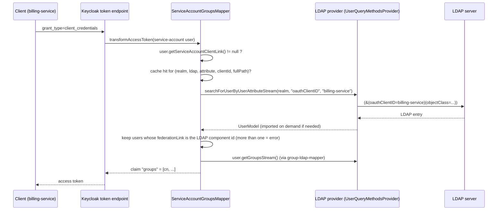
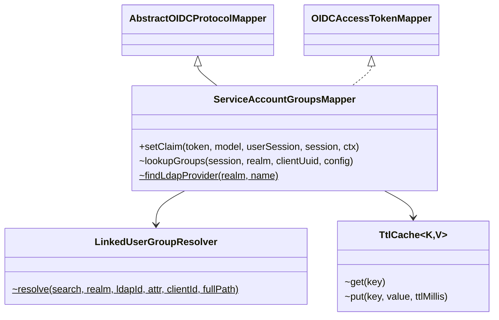

# kc_service-account-groups-mapper

[](https://github.com/JoWe112/kc_service-account-groups-mapper/actions/workflows/ci.yml)
[](LICENSE)


Keycloak protocol mapper that adds groups from a linked federated (LDAP) user to service account tokens in the Client Credentials flow.

| | |
|---|---|
| Maven artifact | `it.westlund.keycloak:kc_service-account-groups-mapper` |
| JAR | `kc_service-account-groups-mapper.jar` |
| Provider ID | `oidc-service-account-groups-mapper` |
| Admin UI name | **Service account groups (via linked user)** |
| Class | `it.westlund.keycloak.mappers.ServiceAccountGroupsMapper` |
| Target | Keycloak 26.6.x, Java 21 |

## Supported Keycloak versions

Each Keycloak minor line has its own branch and release series. The mapper code is the same;
only the Keycloak (and server-provided) dependency versions and the integration-test image differ.

| Branch | Keycloak | Releases | Built and tested against | Status |
|---|---|---|---|---|
| `keycloak-26.8` | 26.8.x | `v26.8.x` | 26.8.1 | **Recommended** |
| `main` | 26.6.x | `v26.6.x` | 26.6.4 | Maintained, but see the warning below |

> [!WARNING]
> **Keycloak 26.6.4 has unpatched security vulnerabilities**, including a critical account
> takeover (CVE-2026-18963, GHSA-4gv3-mc9p-5wqc). No community Keycloak 26.6.x release after
> 26.6.4 exists, so there is no fixed 26.6 server to move to. The mapper JAR itself does not
> contain Keycloak code; the risk is in the Keycloak server it runs in. **Run Keycloak 26.8.x
> with mapper `v26.8.0`.** Details in [#31](https://github.com/JoWe112/kc_service-account-groups-mapper/issues/31).

Deploy the JAR from the release that matches your server. The JAR manifest records both the
release (`Implementation-Version`) and the Keycloak version it was built against
(`Keycloak-Version`).

## Project overview

A client using the **Client Credentials** flow authenticates as its *service account*, which is
a local Keycloak user with no LDAP group memberships. In this setup the client's permissions are
stored in LDAP, on an LDAP user that represents the client. A `group-ldap-mapper` already loads
them into Keycloak.

This mapper links the two. In LDAP, the client's user carries `oauthClientID=<clientId>`. When a
token is issued for the client's service account, the mapper finds that user and puts its group
names (`cn`) into the access token as a multivalued claim:

```json
{
  "azp": "billing-service",
  "groups": ["billing-readers", "billing-writers"]
}
```

## Design



1. **Service accounts only.** Users without `getServiceAccountClientLink()` are skipped.
2. **Lookup.** The client's `clientId` is searched as the value of the configured user attribute
   (default `oauthClientID`) with `searchForUserByUserAttributeStream(realm, attribute, clientId)`.
   The search goes to the configured LDAP provider. See
   [Deviation from the original design](#deviation-from-the-original-design-keycloak-266).
3. **Security check.** Only users whose `getFederationLink()` equals the configured LDAP
   provider's component id are accepted. A local user with the same attribute is ignored, so
   nobody can inherit a client's permissions by setting the attribute on a local user.
4. **Groups.** `user.getGroupsStream()` gives the group names, or full paths
   (`ModelToRepresentation.buildGroupPath`) when configured. The values are sorted.
5. **Claim.** The groups are added as a multivalued (JSON array) claim. If there is no linked
   user, the claim is the empty list `[]`. The claim is **absent** only when a lookup failed
   with fail closed turned off. Consumers can therefore tell "no groups" apart from "lookup
   failed".

### Error handling

| Situation | Fail closed = on (default) | Fail closed = off |
|---|---|---|
| No linked LDAP user | Token issued, `groups: []` | Token issued, `groups: []` |
| Only local users carry the attribute | Token issued, `groups: []` | Token issued, `groups: []` |
| More than one linked LDAP user (ambiguous) | `500 server_error`, no token | Token issued, no claim |
| LDAP unreachable | `500 server_error`, no token | Token issued, no claim |
| Configured LDAP provider missing or disabled | `500 server_error`, no token | Token issued, no claim |

The client receives only a generic error:

```json
{"error": "server_error", "error_description": "Unable to resolve client groups"}
```

The details are logged server-side by `it.westlund.keycloak.mappers.ServiceAccountGroupsMapper`.

> **Cache and fail closed.** A cached result is served without contacting LDAP. If LDAP goes
> down, clients with a valid cache entry keep receiving tokens with their last known groups
> until the entry expires (at most *Cache TTL* seconds). After that, fail closed applies. Set
> the TTL to `0` if every token must reflect a live LDAP lookup.

### Cache

Keycloak does not cache attribute searches, so every token request would query LDAP. The mapper
has its own cache:

- It is a TTL cache keyed by **(realm, LDAP component, attribute name, clientId, full-path flag)**.
  The extra key parts stop two mapper configurations with different settings from sharing entries.
- It is thread-safe (`ConcurrentHashMap`). The TTL is set per mapper (seconds; `0` = off).
- It holds at most 10 000 entries by default. You can change that with
  `--spi-protocol-mapper--oidc-service-account-groups-mapper--cache-max-entries=<n>`. When it is
  full, expired entries are removed first, then the entries closest to expiry.
- Only successful lookups are cached, including "no linked user". Errors are never cached.
- The cache is per Keycloak node and lives in memory. Changes in LDAP (new group, new linked
  user, removed membership) show up after at most the TTL. The same applies to an LDAP outage.
  See [Error handling](#error-handling).

### Deviation from the original design (Keycloak 26.6)

The original design used `session.users().searchForUserByUserAttributeStream(...)`. In Keycloak
26.6, `UserStorageManager` wraps every storage provider query in
`queryWithGracefulDegradation`. It **catches the LDAP exception, logs a warning and returns an
empty result**. Through `session.users()`, "LDAP unreachable" therefore looks the same as "no
linked user", or returns a stale local copy of an imported user. Fail closed cannot work that way.

The mapper therefore calls the **same method with the same signature** on the configured LDAP
provider:

- The LDAP component is found with
  `realm.getComponentsStream(realm.getId(), UserStorageProvider.class.getName())`, filtered on
  `providerId == "ldap"` and the configured name.
- The provider instance comes from `session.getProvider(UserStorageProvider.class, component)`.
  That is the same session-scoped instance `UserStorageManager` uses.
- The instance is cast to the generic SPI interface `UserQueryMethodsProvider`, never to
  `LDAPStorageProvider`. `keycloak-ldap-federation` is **not** a dependency.

The `federationLink` check is still applied as defense in depth.

## Installation / setup

### Requirements

- Keycloak **26.6.x** (built and tested against 26.6.4)
- Java 21 and Maven 3.9+, or Docker (see below)

### Build

```bash
mvn package
# -> target/kc_service-account-groups-mapper.jar
```

To build without a local JDK:

```bash
docker run --rm -u "$(id -u):$(id -g)" -v "$PWD":/work -v "$HOME/.m2":/m2 -w /work \
  maven:3.9.9-eclipse-temurin-21 mvn -B -Duser.home=/m2 -Dmaven.repo.local=/m2/repository package
```

The JAR is thin. Every Keycloak dependency has scope `provided`, and the JAR holds only this
project's classes plus `META-INF/services/org.keycloak.protocol.ProtocolMapper`.

### Deploy

```bash
cp target/kc_service-account-groups-mapper.jar /opt/keycloak/providers/
/opt/keycloak/bin/kc.sh build          # needed for optimized (production) starts
/opt/keycloak/bin/kc.sh start --optimized
```

For container images, `COPY` the JAR into `/opt/keycloak/providers/` before `RUN kc.sh build`.
At startup Keycloak logs `KC-SERVICES0047 ... is implementing the internal SPI protocol-mapper`.
This is expected for every custom protocol mapper.

## Usage

### 1. Map `oauthClientID` from LDAP to a user attribute

**User federation → *your LDAP provider* → Mappers → Add mapper**

| Field | Value |
|---|---|
| Name | `oauthClientID` |
| Mapper type | `user-attribute-ldap-mapper` |
| User Model Attribute | `oauthClientID` |
| LDAP Attribute | `oauthClientID` |
| Read Only | On (recommended) |
| Always Read Value From LDAP | Off |
| Is Mandatory In LDAP | Off |

The LDAP search is built from this mapper. Keycloak translates the user model attribute to the
LDAP attribute in the query filter, so the two names may differ. The integration test maps
LDAP `employeeType` to `oauthClientID`. Without this mapper, the search sends the Keycloak
attribute name to LDAP unchanged.

A `group-ldap-mapper` for the client's groups is also required.

### 2. Add the mapper to the client

**Clients → *client* → Client scopes → *&lt;client&gt;-dedicated* → Configure a new mapper /
Add mapper → By configuration → Service account groups (via linked user)**

The client must have **Client authentication** and **Service account roles** turned on.

### 3. Configuration options

| Option (admin UI) | Config key | Default | Description |
|---|---|---|---|
| Token Claim Name | `claim.name` | `groups` | Claim name. Dots create nested claims (Keycloak convention). |
| User attribute | `user.attribute` | `oauthClientID` | Keycloak user attribute holding the client's `clientId`. |
| LDAP provider | `ldap.provider` | *(empty)* | Name of the LDAP user federation provider. Empty = first **enabled** LDAP provider in the realm, lowest priority value first. Used for the `federationLink` check. |
| Cache TTL (seconds) | `cache.ttl` | `60` | `0` disables the cache. |
| Full group path | `full.path` | `false` | `/parent/child` instead of `child`. |
| Fail closed | `fail.closed` | `true` | On error, reject the token request with `server_error`. |
| Add to access token | `access.token.claim` | `true` | Standard Keycloak toggle. |
| Add to lightweight access token | `lightweight.claim` | `false` | Standard Keycloak toggle. |

Server-level SPI option:

| Option | Default |
|---|---|
| `--spi-protocol-mapper--oidc-service-account-groups-mapper--cache-max-entries` | `10000` |

### 4. Try it

```bash
curl -s -u billing-service:<secret> -d grant_type=client_credentials \
  https://<host>/realms/<realm>/protocol/openid-connect/token \
  | jq -r .access_token | cut -d. -f2 | base64 -d 2>/dev/null | jq .groups
```

## Verifying lookup of LDAP users not yet imported into Keycloak

**Short answer: they are found.** In 26.6 the LDAP provider's `searchForUserByUserAttributeStream`
runs an LDAP query for the attribute and imports any match that is not yet in the local database
(`importUserFromLDAP`). No full sync is needed. The integration test proves this with a user that
was never synced.

To check it in your own environment:

1. Create a fresh LDAP entry (e.g. `uid=svc-new`) with `oauthClientID=new-client` and group
   memberships. Do **not** run a sync, and do not open the user in the admin console. Opening it
   imports the user.
2. Create the client `new-client` with a service account and this mapper. For the test, set the
   cache TTL to `0`.
3. Request a token with the Client Credentials flow. The `groups` claim should contain the LDAP
   groups.
4. Look up the user: **Users → search `svc-new`**, or
   `kcadm.sh get users -r <realm> -q username=svc-new -q exact=true --fields username,createdTimestamp,federationLink`.
   `federationLink` should be the LDAP component id. `createdTimestamp` should equal the time
   of the token request in step 3, because that is when the user was imported. Together these
   two fields prove the user was imported on demand. The integration test makes exactly this
   check.

If the claim is missing, check these in order:

| Check | Fix |
|---|---|
| Server log shows the LDAP filter `(&(oauthClientID=new-client)(objectclass=...))`? If the filter uses another attribute name, the `user-attribute-ldap-mapper` is missing or misnamed. | Fix the mapper (step 1 under Usage). |
| The entry is outside *Users DN* / *Search scope*, or is excluded by *Custom User LDAP Filter*. | Adjust the provider settings. |
| *Import Users* is off. On-demand lookup still works, but the user is not stored. | Nothing to fix. This is expected. |
| You still cannot find it. | Use the fallback: **User federation → LDAP → Action → Sync all users**, then retest. Afterwards turn on *Periodic full sync* or *Periodic changed users sync*. This works around the problem; on-demand import should not need it. |

## Testing

```bash
mvn test        # 37 unit tests (cache, resolver, mapper with mocked Keycloak models)
it/run-it.sh    # integration test: Keycloak 26.6.4 + OpenLDAP in Docker (needs target/*.jar)
```

The integration test uses `cache.ttl=0`, so every request reaches LDAP. It checks these cases:

| Case | Expected |
|---|---|
| Linked LDAP user, never synced | `groups = ["billing-readers","billing-writers"]`; user imported during the token request |
| Local user with the same attribute + local group | `groups = []` |
| No linked user | `groups = []` |
| Two LDAP users with the same client id | `500 server_error` |
| Same, fail closed off | token issued, no claim |
| LDAP stopped | `500 server_error` |

## Architecture



| File | Responsibility |
|---|---|
| `ServiceAccountGroupsMapper` | Mapper factory and instance: admin-UI config, service-account gating, LDAP provider selection, cache, fail closed/open, claim output |
| `LinkedUserGroupResolver` | Search, `federationLink` filtering, ambiguity check, group names/paths |
| `TtlCache` | Bounded thread-safe TTL cache |

## Versioning and releases

Versions are `<Keycloak major>.<Keycloak minor>.<patch>`:

- The first two numbers name the Keycloak line the JAR is built for (`26.6`, `26.8`). They
  follow Keycloak, not the mapper's own API, so they deviate from strict SemVer.
- The patch number counts mapper releases on that line. It starts at `0` and is independent of
  Keycloak's patch version (e.g. `26.6.1` can still target Keycloak 26.6.4).
- Breaking changes to the mapper's configuration are called out in the CHANGELOG.

Each release is tagged on its branch as `v<version>` (`v26.6.0` on `main`, `v26.8.0` on
`keycloak-26.8`). Bump the pom version and the CHANGELOG in the same PR as the change.

## License

[Apache-2.0](LICENSE)
